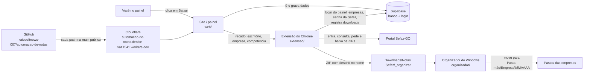

# Mapa do projeto — Automação de Notas (Sefaz-GO)

Guia rápido para achar **onde mexer** em cada parte. Os nomes entre `crases` são arquivos e funções; procure por eles com Ctrl+F no GitHub.

## Como as peças se ligam



| Parte | Onde fica | Conta |
|---|---|---|
| Código | GitHub `kaiosoftnews-007/automacao-de-notas`, branch `main` | Kaio |
| Site no ar | Cloudflare Workers: `automacao-de-notas.denise-vaz1541.workers.dev` | Denise |
| Banco, logins, senha da Sefaz (Vault) | Supabase, projeto `ankmyrxwxaevxmorfedd` (automacao-de-notas) | Denise |
| Extensão | Chrome do PC do escritório, "Carregar sem compactação" da pasta `extensao/` | — |
| Organizador | `%LOCALAPPDATA%\AutomacaoNotas\` no PC do escritório (instalado pelo `INSTALAR-ORGANIZADOR.bat`) | — |

## Pastas do repositório

```
automacao-de-notas/
├─ web/                     → SITE (painel). Publicado pelo Cloudflare a cada push.
│  ├─ index.html            → carrega o site. Mude o ?v=AAAAMMDDHHMM ao alterar app.js/styles.css (força o navegador a pegar a versão nova)
│  ├─ app.js                → todas as telas e regras do painel
│  ├─ styles.css            → cores, fontes, tabelas
│  ├─ config.js             → endereço e chave PÚBLICA do Supabase
│  └─ _headers              → cache do Cloudflare (no-cache)
├─ extensao/                → EXTENSÃO DO CHROME (faz o download na Sefaz)
│  ├─ manifest.json         → nome, VERSÃO (aumente a cada mudança), permissões, sites onde roda
│  ├─ painel.js             → roda no site: passa o login do painel e o botão "Baixar" para a extensão
│  ├─ background.js         → central: fala com o Supabase, abre a aba da Sefaz, nomeia downloads, avisos
│  ├─ login.js              → leva a aba até a consulta: login, card Acesso Restrito, menu Baixar XML NFE
│  ├─ content.js            → na tela de consulta: preenche, pesquisa, pede, espera o histórico e baixa
│  └─ popup.html / popup.js → janelinha do ícone (login manual, escolher escritório)
├─ organizador/             → script do Windows que move os ZIPs para as pastas das empresas (baixado à parte em Atualizações)
├─ supabase/migrations/     → SQL do banco, em ordem (0001 … 0006)
├─ robo/                    → robô antigo em Python (Playwright). Hoje NÃO é usado: a extensão substituiu.
├─ wrangler.jsonc           → configuração do Cloudflare (publica a pasta web/)
└─ docs/MAPA-DO-PROJETO.md  → este arquivo
```

## Quero mudar… → onde mexer

### Site (painel) — `web/app.js`
| O que | Função |
|---|---|
| Menu lateral, "Robô online/offline" | `layout`, `carregarMenu` |
| Tela de login / nova senha | `telaLogin`, `telaNovaSenha` |
| Painel geral (cards, tabela de escritórios) | `telaPainel` |
| Números por competência (de onde vêm entrada/saída) | `carregarBase` (filtra `downloads` pela competência) |
| Status de download (OK, Erro, Na fila…) | `statusDownload`, constante `ST_DL` |
| Visão de entregas (PGDAS, EFD…) | `telaEntregas`, constantes `OBRIG`, `ST_ENT`, `CICLO` |
| Lista de escritórios / editar escritório | `telaEscritorios`, `editarEscritorio` |
| Página do escritório (empresas, botões Baixar) | `telaEscritorio` |
| Botão **Baixar** / **Baixar agora** (manda para a extensão) | `pedirExecucao` |
| Cadastro da empresa (IE, pasta mãe, entregas) | `telaEmpresa` |
| Importar planilha Excel | `importarPlanilha` |
| Alertas | `telaAlertas` |
| Acesso à Sefaz (CPF e senha do contador) | `telaAcesso` |
| Rotina (pasta mãe, período) | `telaRotina` |
| Competência padrão e lista de meses | `compPadrao`, `compOpcoes` |
| Rotas (endereços #/…) | `rota` |

### Extensão — passo a passo de um download
| Etapa | Arquivo → função |
|---|---|
| Clique em Baixar chega na extensão | `painel.js` → `background.js` (`m.tipo === 'executar'`) |
| Abre a Sefaz em segundo plano | `background.js` (`executar`) |
| Login no portal (CPF com máscara) | `login.js` (parte "1) Tela pedindo senha") + `background.js` (`preencherLogin`) |
| Card Acesso Restrito e menu Baixar XML NFE | `login.js` (partes 3 e 4) + `background.js` (`clicar`) |
| Lista de empresas e período (competência) | `content.js` → `iniciar` |
| Preenche e pesquisa | `content.js` → `preencherEPesquisar`, `lerResultado` |
| Pede "Baixar todos" | `content.js` → `pedirDownload`, `pedido` |
| Espera o Histórico e baixa (uma empresa por vez) | `content.js` → `historico` |
| Ordem das etapas | `content.js` → `passo` |
| Aviso "Confirme que é humano" | `content.js` → `esperarVerificacao` + `background.js` (`verificacao`) |
| Nome do ZIP com o destino | `content.js` → `historico` (variável `guia`) |
| Registra no painel | `content.js` → `banco`, `execucao` |
| Tempos (espera, pausas, tentativas) | `content.js`, linha `const ESPERA_VERIFICACAO … MAX_HIST` |

### Organizador — `organizador/organizar.ps1`
| O que | Função |
|---|---|
| Lê o destino do nome do ZIP | `GuiaDoNome` |
| Acha ou cria a pasta da empresa na pasta mãe | `PastaDaEmpresa` |
| Comparação de nomes (sem acento/maiúscula) | `Normal` |
| Histórico do que moveu | arquivo `%LOCALAPPDATA%\AutomacaoNotas\organizador.log` |

### Banco — `supabase/migrations/`
| Arquivo | O que faz |
|---|---|
| `0001_schema.sql` | Tabelas (escritórios, empresas, rotinas, execuções, downloads, entregas, alertas), regras de acesso e senha no Vault |
| `0002_limpar_senha_ao_excluir.sql` | Apaga a senha da Sefaz ao excluir escritório |
| `0003` / `0004` | Deixa a extensão registrar downloads e atualizar a execução |
| `0005_extensao_le_login_sefaz.sql` | Função que entrega o login da Sefaz à extensão (só do escritório do usuário) |
| `0006_pasta_da_empresa.sql` | Campo `pasta` (pasta mãe da empresa) |

Mudança no banco = novo arquivo `0007_….sql` aqui **e** rodar no SQL Editor do Supabase.

## Como publicar uma alteração

| Mudou | Faça |
|---|---|
| `web/` | Push na `main` → o Cloudflare publica em 1–2 min. Aumente o `?v=` no `index.html`. Ctrl+F5 no painel. |
| `extensao/` | Aumente `version` no `manifest.json`. No PC: extraia por cima da mesma pasta → ↻ em `chrome://extensions` → feche as abas da Sefaz → F5 no painel. |
| `organizador/` | Rodar de novo `INSTALAR-ORGANIZADOR.bat` (fecha o antigo e inicia o novo). |
| Banco | Novo `supabase/migrations/000X_….sql` + rodar no SQL Editor. |

## Conexões (situação em 13/11/2026)

| Conexão | Status | Como foi verificado |
|---|---|---|
| Site → Supabase | ✅ em uso | `web/config.js` aponta para `ankmyrxwxaevxmorfedd`; painel lista escritórios, empresas e downloads |
| Extensão → Supabase | ✅ em uso | `extensao/background.js` (mesmo projeto e chave pública); downloads de out/2026 e set/2026 registrados |
| GitHub → Cloudflare | ✅ em uso | cada push na `main` publicou o site (versão nova do `app.js` servida minutos depois) |
| Cloudflare → site | ✅ em uso | `wrangler.jsonc` publica `web/` como site estático em `*.workers.dev` |
| Robô Python → Supabase | ⏸ parado | `robo/` existe, mas não está instalado ("Robô offline" no painel). A extensão faz o trabalho. |

Chaves: a chave **pública** (`sb_publishable_…`) pode ficar no código; a segurança vem das regras do banco. A chave **secreta** (`sb_secret_…`) nunca vai para o GitHub.

## Pontos de atenção
- A IE da **GARRAFAIS MATRIZ** está com 13 números; em Goiás são 9.
- O Chrome com a extensão precisa estar aberto no PC do escritório, com o painel logado.
- O organizador precisa estar rodando para os ZIPs saírem de `Downloads\Notas Sefaz\_organizar`.
